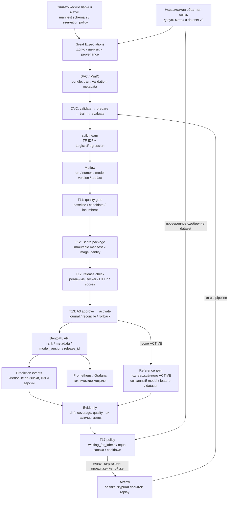

# Архитектура локального ATS MLOps

Стенд ранжирует переданный список резюме для одной вакансии и связывает ответ API
с точными версиями данных, кода, модели и выпуска. Решение о найме остаётся за
человеком. Контракты входов, ответов и меток заданы в [data-contract.md](data-contract.md),
а проверяемые свойства — в [requirements.md](requirements.md).

## От курсовой к реализации

Ядро локального/гибридного варианта курсовой состоит из **MLflow, Apache Airflow,
DVC, Evidently и BentoML**. Расширенные заметки рассматривают четырнадцать
функциональных классов: к ядру добавлены GitHub, GitHub Actions, Docker,
Docker Compose, Great Expectations, Optuna, Prometheus/Grafana и MinIO;
Feast остаётся условным расширением и в стенде не развёрнут. DOCX сравнивает
готовые архитектуры, а расширенные заметки — инструменты по классам; весь
комплекс нельзя приписывать одной процедуре сравнения.
Основание и границы переноса приведены в [исходном плане](plans/reproducible-ml-ats/plan.md#источники-решения-и-исходное-состояние).

Python/scikit-learn и служебная PostgreSQL согласованы как решения реализации
в [decisions.md](decisions.md). Число функциональных классов не означает число
одновременно работающих сервисов. Docker Compose запускает локальные профили;
Airflow и ML runtime используют отдельные закреплённые окружения. Версии,
lockfiles и платформа описаны в [versions.md](versions.md).

## Потоки данных и управления

Допуск выполняется до регулярного DAG. Bundle переносит train/validation и
проверенную metadata; исходные тексты test в него не входят. DVC отслеживает
входы и результаты стадий. Airflow вызывает тот же pipeline, который доступен
через CLI, и хранит идентичность заявки отдельно от `dag_run_id`.
См. [reproducibility.md](reproducibility.md) и [runbook.md](runbook.md).

TF-IDF обучается только на train. Модель использует признаки сходства пары и
логистическую регрессию; Jaccard служит отдельным baseline. Optuna доступна для
поиска по validation. В замороженной экспериментальной конфигурации поиск
отключён: `search.mode=frozen`, ноль HPO trials. Cache hit и восстановленный
MLflow run не считаются новым fit. Реализация находится в
[pipeline.py](../src/ats_mlops/pipeline.py), [training.py](../src/ats_mlops/model/training.py)
и [features/pairs.py](../src/ats_mlops/features/pairs.py).

Модельный gate не активирует сервис. После него отдельно выполняются упаковка,
проверка выпуска, A3 approval и активация. Serving загружает локальный артефакт
из пакета с точным image ID; запрос не выбирает модель через mutable alias.
Контроллер сверяет incumbent, готовность API и Registry, сохраняет intent до
эффектов и использует журнал для восстановления. Подробности:
[quality.md](quality.md), [serving.md](serving.md), [releases.md](releases.md);
код — [quality/gate.py](../src/ats_mlops/quality/gate.py),
[service/package.py](../service/package.py), [service/release_check.py](../service/release_check.py)
и [release/controller.py](../src/ats_mlops/release/controller.py).

## Состояние, события и обратная связь

| Состояние | Где хранится | Что сохраняется при повторе или отказе |
|---|---|---|
| Код, параметры и зависимости | Git, lockfiles, точные Docker image IDs | Исполняемый source отделён от изменяемого DVC workspace |
| Данные и артефакты | DVC/MinIO; MLflow artifact proxy | Хеши, manifest, split, run и numeric model version |
| Служебные БД | Отдельные роли и БД PostgreSQL для MLflow/Airflow | Credentials и volumes сохраняются вместе; повторный init не меняет пароли |
| Заявки обучения и policy | SQLite в orchestration state volume | Payload binding, бюджет попыток, состояния заявки и cooldown |
| Выпуск | Внешний state directory: `journal.jsonl`, receipts, `state.json` | Журнал — источник истины; projection не редактируется для обхода блокировки |
| Prediction events | SQLite в Linux named volume serving | Полные числовые события до `top_k`, исходный ответ для idempotent replay |
| Финальный holdout | Отдельный долговечный ledger OS account | Один попытанный доступ для защищённой lineage, без reset при смене study/model ID |

Тексты резюме и вакансий не записываются в технические события. Export связывает
числовые события с проверенным выпуском; метки принимаются отдельно с их
происхождением. Drift и техническая ошибка не заменяют измерение качества.
Без независимых меток quality остаётся неопределённым, а заявка ждёт данные.
После их допуска продолжается та же заявка; кандидат снова проходит gate,
package, release check и A3. Reference обновляется после проверенного ACTIVE,
а replay/cooldown блокируют повторные эффекты.

Контракты и код этого цикла: [data-contract.md](data-contract.md), [drift.md](drift.md),
[retraining.md](retraining.md), [monitoring.md](monitoring.md),
[feedback.py](../src/ats_mlops/monitoring/feedback.py),
[retraining_batch.py](../src/ats_mlops/monitoring/retraining_batch.py)
и [policy_worker.py](../src/ats_mlops/monitoring/policy_worker.py).
GitHub Actions проверяет отдельные синтетические fixtures в изолированном
контуре; рабочие credentials и доступ к локальному стенду ему не передаются.
Профили и тома заданы в [compose.yaml](../compose.yaml), CI — в [ci.md](ci.md).

## Какая версия что подтверждает

[T18](acceptance.md) подтвердил восемь инженерных сценариев; их source history
записана в [публичном summary](../reports/acceptance/t18/summary.json).

| Свидетельство | Исполняемый source |
|---|---|
| Первый заранее выбранный S1 candidate; S1–S5 | `01ccf13d123857ea7b0c8c36fef6c29a13935b78` |
| S6–S8 и финальный исполняемый протокол freeze | `14be8edffb68a2320404e8e1a03f37a740694466` |

В spec поля `qualified_model_source_git_sha` и `source_git_sha` разделяют
происхождение выбранной модели и версию исполняемого протокола. Проверка T18
связывает исторические Git bytes и исходные phase/spec/environment receipts;
поздний код исправлений, merge или документационный HEAD не переименовывает
source обучения. Негативный model fixture имеет отдельную producer identity
и не заменяет первый S1 candidate. Эти границы проверяют
[audit.py](../tests/e2e/audit.py) и [native.py](../src/ats_mlops/evaluation/native.py).

PASS T18 относится к готовности инженерного цикла. Формальные E1–E5 имеют
отдельные попытки, receipts и [протокол](experiment-protocol.md); результаты
приёмки не подменяют их измерения. E2 требует настоящих human manual/auto пар.
Финальные таблицы восстанавливаются из сохранённых чисел через
[experiment.py](../src/ats_mlops/evaluation/experiment.py), без повторного
оценивания test. Публичная проекция T18 содержит безопасную часть доказательств;
для полного replay audit нужен сохранённый приватный freeze.

Корпус имеет `evidence_scope=demo_only`. Успешные checks подтверждают поведение
этой реализации на синтетике; они не устанавливают пользу для реального найма,
честность ранжирования на рынке труда или вероятность трудоустройства.
