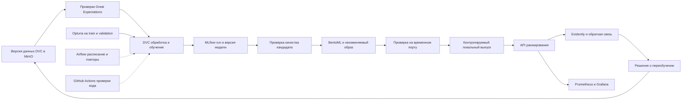

# Plan: реализация диплома по автоматизации жизненного цикла ML в ATS

## Context & Decision

Актуализация 26.10.2026: пакет T-1 и bootstrap согласованы; рекомендуемые инженерные решения делегированы агенту. Выбран синтетический инженерный сценарий demo_only, Python/scikit-learn и PostgreSQL. Записи авторизации и порядок локального demo approval — в docs/decisions.md; версии T-2 и данные T-3 ещё не проверены. Ниже сохранено обоснование исходного плана. Пути с префиксом ats_mlops обозначают корень этого репозитория; исследовательские материалы перечислены по внешним именам и в этот репозиторий не включены.

Тема диплома: **«Автоматизация жизненного цикла воспроизводимого машинного обучения в интеллектуальных системах подбора персонала»**. Необходимо реализовать исследовательский стенд на технологиях, выбранных в курсовой, и экспериментально проверить воспроизводимость, автоматизацию и восстановление после ошибок. Этот документ описывает будущую реализацию; код, датасет, модели и измерения пока отсутствуют.

Практический сценарий для плана — **ранжирование предоставленного списка резюме по релевантности одной вакансии**. Это рабочая постановка, поскольку в курсовой конкретная ML-задача не закреплена. Система выдаёт рекомендации специалисту по подбору персонала; решение о найме в её функции не входит.

### Источники решения и исходное состояние

1. `Тема.md:1` — утверждённая пользователем формулировка темы.
2. `NIR-2_с_матрицами.docx`, XML-абзацы 263–266 и 803–824 — A1 для локального/гибридного сценария: **MLflow + Apache Airflow + DVC + Evidently + BentoML**. Абзацы 835–841 относят прототип и экспериментальную проверку к следующему этапу. XML-абзацы включают ячейки таблиц и пустые абзацы, это не номера страниц.
3. `НИР 1/04 Результаты/Выбор инструментов ELECTRE II/08 — Итоговый комплекс по результатам ELECTRE II.md:8` — расширенный выбор по функциональным классам: GitHub, GitHub Actions, Docker, Docker Compose, DVC, Great Expectations, MLflow, Optuna, Airflow, BentoML, Evidently, Prometheus/Grafana, MinIO; Feast — при необходимости.
4. DOCX сравнивает готовые архитектуры, текущие заметки — инструменты четырнадцати классов. Они подтверждают общее ядро, но описывают разные процедуры выбора. **Нельзя приписывать DOCX выбор всего расширенного комплекса.** В T-1 фиксируется согласованная редакция обоснования для диплома; повторное сравнение платформ не является задачей реализации.
5. На 25.10.2026 `ats_mlops/` содержит только `.git`: локально нет коммитов, исходников, моделей и тестов. Состояние удалённого репозитория не проверялось. В `openspec/` нет спецификаций, а `scripts/` содержит оформление DOCX, не реализацию ML. Следовательно, план рассчитан на разработку с нуля. Если обнаружится готовый код на remote, сначала повторяется аудит, затем корректируется план.

### Планируемый результат и проверяемые требования

| ID | Результат, который требуется получить | Подтверждение |
|---|---|---|
| R-1 | Для модели прослеживаются код, данные, признаки, параметры, окружение, проверки и выпуск | Полный manifest; три независимых принудительных пересчёта |
| R-2 | Данные с нарушением контракта блокируются до обучения | Негативные фикстуры и отчёт Great Expectations |
| R-3 | Обучение, подбор параметров и регистрация экспериментов выполняются повторяемо | DVC DAG, Airflow DAG, MLflow runs и Optuna study |
| R-4 | BentoML возвращает воспроизводимое ранжирование и точную версию модели | Контракт API, контрольные запросы из отдельного окружения |
| R-5 | Выпуск требует проверенного артефакта; неудачный выпуск восстанавливает предыдущую версию | Журнал переходов и тесты отказа/отката |
| R-6 | Наблюдение отличает дрейф от измеренного изменения качества; переобучение проходит те же проверки | Отчёты Evidently, метки обратной связи, сценарии повторного обучения |
| R-7 | Изменения кода проверяются GitHub Actions в изолированном контуре | Успешный CI и намеренно отклонённые некорректные изменения |
| R-8 | Диплом содержит воспроизводимые измерения, исходные результаты и ограничения | Протокол, CSV/JSON результатов, графики, инструкция демонстрации |

## Technical Approach

### Выбранный стек и границы ответственности

| Инструмент | Роль в реализуемом стенде | Граница ответственности |
|---|---|---|
| GitHub, GitHub Actions | Код, проверки изменений и сборка тестовых образов | CI не получает доступ к локальному стенду и реальным данным |
| Docker, Docker Compose | Фиксация окружений и локальный запуск сервисов | Учебное развёртывание на одной машине |
| DVC | Версии датасетов и файловый DAG обработки/обучения | Единственный источник зависимостей стадий `prepare → train → evaluate` |
| Great Expectations | Проверки схемы, полноты, уникальности и допустимости значений | Ошибка обязательной проверки завершает запуск до обучения |
| MLflow | Эксперименты, артефакты, версии моделей и aliases | Alias не заменяет идентификатор реально запущенного образа |
| Optuna | Подбор параметров на train/validation | Финальный test не участвует в поиске |
| Apache Airflow | Расписание, запуск DVC, повторы, журнал исполнения | Не дублирует стадии DVC и не запускает параллельную запись в общую копию |
| BentoML | Упаковка модели и API ранжирования | Загружает конкретную одобренную версию, без `latest` при выпуске |
| Evidently | Дрейф признаков/предсказаний, отчёты о качестве при наличии меток | Дрейф — сигнал исследования, а не доказательство деградации |
| Prometheus, Grafana | Задержка, ошибки, доступность и состояние конвейера | В labels нет текстов резюме, candidate_id или request_id |
| MinIO | Объектное хранение DVC, MLflow и отчётов | Разные buckets/prefixes и учётные записи для разных назначений |
| Feast | Возможное последующее расширение | Добавляется лишь при обоснованной потребности online/offline feature serving |

**Новые проектные предложения, не результаты выбора курсовой:** Python и scikit-learn для простой модели; PostgreSQL как локальная служебная БД Airflow и MLflow с отдельными БД/ролями. Их добавление и точные версии согласуются в T-1 до изменения зависимостей. В рамках подготовки плана ничего не устанавливается. Если предложение не принято, T-1 корректирует соответствующие задачи до программирования; автоматически заменять стек нельзя.

### Поток данных и артефактов

### Данные и прикладная ML-задача

- Единица наблюдения: пара `vacancy_id, candidate_id`, тексты вакансии и резюме, независимая метка `relevance ∈ {0,1}`. Для оценки хранится группа кандидатов на одну вакансию.
- T-1/T-3 выбирают корпус с документированным происхождением и допустимым использованием. Требуются идентификаторы, метки и достаточное число групп для train/validation/test. Название и размер корпуса пока **не установлены**; их нельзя выдавать за результаты курсовой.
- Полностью публикуемые синтетические фикстуры обязательны для CI, ошибок и демонстрации. Если независимого размеченного корпуса не будет, можно завершить инженерные эксперименты на синтетике, но выводы об эффективности реального подбора персонала исключаются. Это фиксируется в протоколе до экспериментов, а не после получения результатов.
- Разбиение выполняется до обучения преобразований. Одинаковые вакансии, кандидаты и близкие дубликаты текстов не попадают в разные части: группы формируются по связанным идентификаторам/дубликатам. Если получилась одна связная компонента или часть без положительных примеров, данные непригодны для выбранной проверки; split не «исправляется» случайным разбиением строк. При доступных датах предпочтительно временное разбиение с теми же ограничениями утечки.
- В `data_manifest.json` фиксируются источник, лицензия/условия, схема, хеш, объём, положительные метки, правила очистки и конкретные списки split. Тестовая часть замораживается; подбор параметров и регулярный выпуск её не читают.
- Минимальная модель сравнения — детерминированный token-overlap/Jaccard. Проектное предложение для обучаемой модели — TF-IDF, обученный только на train, признаки сходства пары и логистическая регрессия. Признаки: cosine TF-IDF, Jaccard токенов, `log1p` длин и отношение длин; точный порядок и обработка пустого словаря версионируются вместе с моделью. Optuna настраивает ограниченный набор параметров, затем обучение повторяется с зафиксированными лучшими параметрами.
- Модель возвращает **оценку релевантности**; её нельзя интерпретировать как вероятность найма. Основная метрика — NDCG@10; дополнительные — Recall@10, доля запросов с оцениваемыми метками и время расчёта. Для групп без положительных меток Recall и NDCG исключаются из среднего: публикуются их количество и доля. Итог — macro-average по допустимым группам, с одинаковым набором групп для сравниваемых моделей; при отсутствии таких групп качество не определено и выпуск с утверждением о качестве запрещён. Ранжирование считается по полной размеченной группе, `k = min(10, размер группы)`.
- Имена, контакты и признаки, не связанные с требованиями вакансии, не используются в модели. В журнале запросов остаются псевдонимные идентификаторы, числовые признаки и версии; полный текст запроса не пишется в технические логи. Данные и артефакты не выгружаются в публичный CI.

### Воспроизводимость и manifest

`run_manifest.json` связывает: `git_sha`, DVC hash и split hash, версию кода признаков, параметры, seed, платформу/CPU-архитектуру, Python и lockfile hash, идентификатор образа, MLflow run/model version, хеши артефактов и отчётов. Времена, run ID и другие служебные поля не входят в сравнение детерминированного содержимого.

После упаковки, **до проверки выпуска**, замораживается `release_manifest.json`: release ID, ссылка/хеш run manifest, точные model version и model hash, Bento tag, image ID, SHA-256 экспортированного архива, хеш модельного gate и ожидаемый предыдущий release ID. Он не включает будущий release check, согласование или меняющееся состояние. `release_check_report.json` отдельно ссылается на его хеш; `approval_receipt.json` связывает хеши manifest и обоих отчётов с оператором и временем. Журнал состояний хранится отдельно. После согласования эти файлы не меняются; новая проверка/согласование создаёт новую ревизию выпуска. Это исключает цикл хешей.

Три проверочных обучения выполняются в новых рабочих каталогах с одной платформой и образом, одинаковыми данными, параметрами, seed и ограниченным числом потоков. Проверка должна **заново выполнить обучение**, а не восстановить готовую модель: после получения входных данных запускается `dvc repro -f --no-run-cache`. Сравниваются хеши подготовленных данных/признаков, порядок кандидатов и численные предсказания (`atol=1e-6`, `rtol=1e-5`), а не бинарное равенство сериализованных моделей. Отдельный сценарий проверяет восстановление готовых артефактов из хранилища. Ограничение одной платформой явно отражается в выводах.

Optuna выполняет фиксированное число последовательных trials, с seed sampler и зафиксированным пространством поиска. Полная study сохраняется. Проверка воспроизводимости финальной модели повторяет обучение с уже выбранными параметрами; воспроизводимость самого поиска оценивается отдельно, без смешения этих двух утверждений.

### Локальная инфраструктура и исполнение

Compose разворачивается постепенно: профиль `core` — MinIO и MLflow со служебной БД; `orchestration` — Airflow; `serving` — BentoML; `observability` — Prometheus/Grafana. Данные, БД и журнал выпусков имеют постоянные volumes. Для Airflow предлагается LocalExecutor, без Redis/Celery и Kubernetes. Доступ к Docker socket Airflow не получает: Docker-команды выпуска выполняет отдельный локальный CLI оператора.

В T-2 составляется проверенная матрица версий и проводится короткая совместимость: модель → MLflow → импорт в BentoML → ответ из отдельного контейнера; DVC → MinIO; GX validation; реальная задача Airflow → короткий ML CLI. Одного импорта DAG недостаточно.

Механизм исполнения фиксирован: специально собранный образ scheduler/LocalExecutor содержит Airflow в своём окружении и **отдельный venv `/opt/ml-venv`** с ML/DVC-зависимостями. Задача Airflow вызывает ML CLI через subprocess с абсолютным путём к этому Python; в ML-процессе PATH указывает на ML-venv. Репозиторий подключён read-only; runner создаёт локальный clone в `/work/<run_id>`, делает detached checkout указанного Git SHA и передаёт его `src/` в PYTHONPATH. Lockfile hash checkout должен совпасть с lockfile hash ML-venv, иначе запуск отклоняется до обучения. Рабочие каталоги находятся на отдельном volume, исходный репозиторий не меняется. В T-2 проверяются настоящий вызов, запись manifest с SHA/lock hash и отклонение несовместимого SHA; внешнего Docker API здесь нет. Конкретные версии и образы закрепляются после проверки, без плавающих тегов `latest`.

`train_candidate` получает `dataset_version`, `git_sha`, `params_hash`, `run_id`. Каждый запуск имеет собственный каталог; `max_active_runs=1` ограничивает одновременность стенда. В XCom передаются только ID и URI. Повторы ограничены двумя попытками после исходной для временных ошибок I/O; ошибки схемы/качества не повторяются. Запись артефактов завершается до регистрации успешного результата, а повтор шага с тем же ключом не создаёт новый выпуск. Сбой оставляет понятный failed run и возможность безопасно запустить новую попытку.

`dvc repro` может пропустить закешированные стадии. Планировщик различает `cache_hit` и `trained`: несуществующий новый MLflow run нельзя считать результатом обучения; при `cache_hit` используется и проверяется manifest исходного запуска. Для исследований и принудительного переобучения используется отдельный режим без run-cache.

Ресурсы полного стека измеряются в T-2/T-4; минимальные требования одного Airflow нельзя переносить на весь стенд. В README указываются реально проверенные RAM/CPU/свободное место, команда запуска профилей и время старта. Стенд привязывает доступные пользователю порты к loopback; внутренние БД остаются в сети Compose. `.env.example` содержит только примеры; рабочие секреты и содержимое volumes не коммитятся.

### API ранжирования

- `POST /rank`: `request_id`, одна вакансия `{id, text}`, список кандидатов `[{id, text}]`, `top_k`.
- Ответ: упорядоченные `{candidate_id, score}`, `model_version`, `release_id`, `request_id`. При одинаковом score используется возрастание `candidate_id`.
- До 100 кандидатов; текст одного объекта — до 10 000 символов; общий запрос — до 1 MiB. `top_k` — от 1 до 100; выдача ограничивается размером списка. Пустой список кандидатов возвращает пустую выдачу. Пустой текст, повторяющиеся ID и неверный `top_k` дают 422; превышенный размер — 413; отсутствие загруженной модели — 503.
- `POST /metadata` возвращает версии и состояние готовности без обучающих данных и секретов. Готовность выпуска проверяется metadata и контрольным rank-запросом. Реализация и API-тесты используют одну закреплённую версию BentoML.
- До усечения по `top_k` сервис сохраняет полный prediction-event на постоянном volume в SQLite через стандартную библиотеку Python; новый внешний сервис для журнала не требуется. Если запись не удалась, запрос завершается 503. Повтор `request_id` с тем же хешем канонического входа возвращает исходный сохранённый результат с исходной версией; тот же ID с другим входом отклоняется 422. Это проверяется и после рестарта.

### Проверка кандидата, выпуск и откат

До упаковки T-11 создаёт **модельный** `gate_report.json`: валидные данные, полный manifest, конечные численные scores и сравнение NDCG@10 кандидата с baseline и действующей моделью **на одном validation split**. Работающего API этот gate ещё не требует. Рабочий допуск — снижение не более 0,005; он фиксируется в `configs/quality.yaml` до итоговых экспериментов. Gate содержит точные incumbent model/release ID, validation hash и hash конфигурации порогов.

У отчёта независимые поля: `outcome = passed | rejected` и `evidence_scope = demo_only | independently_labeled`. Синтетические размеченные фикстуры допускают `passed + demo_only` для инженерной демонстрации полного цикла; они не подтверждают качество реального подбора. `rejected` запрещает выпуск при любом scope. Отсутствие пригодных меток для расчёта метрик не подменяется успешной проверкой: для демонстрации нужен отдельный синтетический размеченный набор.

После упаковки T-12 создаёт **проверку выпуска** `release_check_report.json`: API-контракт, metadata/rank-запросы, автономность контейнера и совпадение scores с моделью. Отчёт связывает точный model version, хеш модели, Bento tag, image ID и хеш release manifest. Staging использует отдельный временный журнал prediction-events, чтобы контрольные запросы не попадали в мониторинг рабочего сервиса. Для `approve/activate` нужны оба отчёта с `outcome=passed`, совпадающими ссылками на модель/артефакты и указанным evidence_scope; изменение образа или модели делает прежнее согласование недействительным.

Переходы: `trained → checked → packaged → staged → approved → active`; ошибка проверки ведёт в `rejected`, ошибка переключения — в `failed → restoring → restored`. Согласование выпуска — явная локальная команда над конкретным release ID с журналом оператора/времени; автоматические проверки выполняются до неё. Такое управляемое продвижение следует рекомендации курсовой о согласовании выпуска, но не требует подтверждения для составления этого плана.

MLflow alias `candidate`/`champion` используется для навигации; упаковка всегда читает **точный model version**, проверенный в gate. Готовый Bento содержит модель и преобразования, и работает без доступа к training checkout. Один процесс выпуска удерживает локальную блокировку; одновременная команда отклоняется. Под этой блокировкой **и approve, и activate** сверяют текущий согласованный release из journal/API/registry с incumbent ID модельного gate; для первого выпуска ожидается отсутствие incumbent. Расхождение блокирует выпуск: нужен повторный gate относительно новой действующей модели на том же validation manifest, новая ревизия release manifest, release check и согласование. Сценарий A → B → попытка C, проверенного ещё против A, обязан отклоняться.

Кандидат проверяется на временном порту, после согласования Compose переключает основной сервис на сохранённый image ID. Краткий перерыв допускается и измеряется; непрерывная доступность не обещается.

Журнал состояний пишется на постоянный volume. Alias `champion` обновляется после готовности основного API. Единой транзакции между Compose и MLflow нет: после сбоя команда `release reconcile` сравнивает journal, metadata API и registry; до успешного согласования новый выпуск блокируется. Предыдущие образ, manifest и конфигурация сохраняются минимум для двух успешных выпусков. При неготовности новой версии автоматически восстанавливается предыдущий образ; недоступность registry не должна выключать уже работающий сервис.

GitHub Actions проверяет код, небольшой набор синтетических данных и временные контейнеры в CI. Локальный MinIO из hosted runner недоступен по умолчанию; обходить это публикацией портов или выдачей приватных секретов нельзя. Сборка реального модельного выпуска и переключение выполняются локально по проверенному Git SHA. Новый container registry, облачный сервис и self-hosted runner в обязательный объём не входят.

### Наблюдение, обратная связь и переобучение

Prometheus собирает счётчики запросов/ошибок, histogram задержки, состояние версии, длительность и исходы DAG. Grafana показывает p50/p95, ошибки, состояние выпусков и конвейеров. Отчёты Evidently используют reference-распределения из train/validation и числовые признаки/предсказания текущего окна; в карточке отчёта есть версии данных и модели.

До ответа `/rank` сохраняется prediction-event: `schema_version, request_id, input_hash, vacancy_id, model_version, release_id, event_time`, полный упорядоченный список `candidate_id, score` и числовые признаки мониторинга по каждой паре. `input_hash` считается по каноническому входу, включая `top_k`; полный текст в журнал не попадает. SQLite обеспечивает уникальность request_id и завершённую запись события до успешного ответа. Отдельный экспорт событий версионируется DVC; он позволяет восстановить исходный полный порядок даже при выдаче `top_k=3` из 100 кандидатов.

Обратная связь хранится отдельным версионируемым набором: `feedback_event_id, request_id, vacancy_id, candidate_id, model_version, relevance, event_time, label_source, label_revision`. Ссылка на prediction-event обязательна; кандидат/версия должны совпадать со снимком. Повтор идентичного feedback_event_id игнорируется, конфликтующее содержимое отвергается. Исправления разметки имеют новую label_revision, история сохраняется; для отчёта выбирается последняя допущенная ревизия до указанного cutoff.

В мониторинге группа — конкретный request_id с полным составом кандидатов из снимка. NDCG/Recall рассчитываются, когда для каждого кандидата известна независимая метка на cutoff; неполные группы исключаются, отдельно публикуются покрытие по парам и по группам. Для полностью размеченных групп без положительных меток действует общее правило исключения из среднего. Непросмотренный кандидат не считается нерелевантным, а прогноз модели не превращается в истинную метку. Test-оценивание группируется по вакансиям, мониторинг — по зафиксированным группам запросов.

Рабочая политика триггера: окно содержит не менее 200 пар и 10 вакансий; сигнал дрейфа срабатывает при нарушении настроенного порога два окна подряд, cooldown — 24 часа, одновременно допускается одна задача переобучения. Конкретные drift tests и пороги выбираются на калибровочной части в T-16 и фиксируются до T-19. Числа — проектные настройки для демонстрации, не выводы курсовой. Тесты используют управляемые часы и фикстуры, без ожидания реальных суток.

При подтверждённом сигнале Airflow проверяет наличие новой одобренной версии размеченных train-данных. Если её нет — состояние `waiting_for_labels`, отчёт и запись в панели; существующая модель продолжает работать. Если есть — запускается новый кандидат через обычный DVC/GX/MLflow/gate; выпуск требует того же согласования. Замороженный test не пополняет обучение. После успешного выпуска меняется reference manifest, история прежних окон сохраняется.

### Этапы, зависимости и ориентировочные сроки

Оценка — **12 недель основной работы и до 2 недель резерва** при регулярной занятости одного разработчика. Это ориентир: даты, оборудование и доступность разметки ещё не заданы. Подготовка текста и иллюстраций идёт параллельно с разработкой.

| Недели | Этап и задачи | Проверяемый результат |
|---|---|---|
| 1 | Постановка и проверка совместимости: T-1, T-2 | Контракт, границы эксперимента, версия стека, проверенный мини-проход |
| 2 | Данные и базовая инфраструктура: T-3, T-4 | Датасет/split, MinIO, MLflow, постоянное хранение |
| 3 | Качество данных и baseline: T-5, T-6 | Плохие данные отклоняются; метрики простого ранжирования |
| 4 | Обучаемая модель и параметры: T-7, T-8 | MLflow lineage, ограниченный Optuna study |
| 5 | Воспроизводимый конвейер: T-9 | DVC DAG, manifest и независимый пересчёт |
| 6 | Оркестрация и gate: T-10, T-11 | Airflow DAG с повторами и проверка кандидата |
| 7 | API и управляемый выпуск: T-12, T-13 | BentoML, staging, согласование, откат |
| 8 | CI и технический мониторинг: T-14, T-15 | GitHub Actions, Prometheus/Grafana |
| 9 | Наблюдение за моделью и обратная связь: T-16 | Отчёты дрейфа/качества и политика срабатывания |
| 10 | Переобучение и проверки отказов: T-17, T-18 | Замкнутый цикл, ожидание меток, восстановление |
| 11 | Экспериментальная серия: T-19 | Таблицы и графики по единому протоколу |
| 12 | Пояснительная записка и защита: T-20 | Воспроизводимый демонстрационный комплект |
| 13–14 | Резерв | Проблемы данных/совместимости и исправления по проверке |

Критический путь: `T-1 → T-2 → T-4/T-3 → T-5 → T-7 → T-9 → T-10 → T-11/T-12 → T-13 → T-16/T-17 → T-18 → T-19 → T-20`. Полные зависимости и проверки приведены в `tasks.md`.

## Affected Modules & Files

Ниже **планируемые новые** пути относительно корня ATS. Они ещё не существуют, кроме файлов этого плана и `Тема.md`.

| Path | Change | Note |
|---|---|---|
| `План реализации диплома.md`, `Тема.md` | New / Modified | Обзорный маршрут и ссылка из темы |
| `docs/plans/reproducible-ml-ats/{plan,tasks,progress}.md` | New | План, проверяемые задачи, состояние реализации |
| `ats_mlops/docs/{requirements,data-contract,versions,experiment-protocol}.md` | New | Контракт и замороженный протокол проверки |
| `ats_mlops/pyproject.toml`, `requirements*.lock`, `.env.example`, `.gitignore` | New | Зависимости, окружение, исключение данных и секретов |
| `ats_mlops/compose.yaml`, `docker/` | New | Профили инфраструктуры, образы и volumes |
| `ats_mlops/configs/`, `data/*.dvc`, `.dvc/`, `dvc.yaml`, `dvc.lock` | New | Конфигурация, версии и DAG |
| `ats_mlops/src/ats_mlops/{data,features,model,evaluation,lineage}/` | New | Предметный ML-код без зависимости от Airflow |
| `ats_mlops/src/ats_mlops/{cli,quality,release,monitoring}/` | New | CLI, gate, журнал выпуска, отчёты и триггеры |
| `ats_mlops/dags/`, `service/`, `great_expectations/` | New | Адаптеры Airflow, BentoML и проверки данных |
| `ats_mlops/.github/workflows/ci.yml`, `tests/{unit,integration,e2e}/`, `tests/fixtures/` | New | CI, контракты, ошибки и синтетические данные |
| `ats_mlops/monitoring/{prometheus,grafana}/` | New | Конфигурация технического наблюдения |
| `ats_mlops/reports/`, `ats_mlops/docs/{runbook,architecture,demo}.md` | New | Метрики и инструкции; крупные артефакты в DVC/MinIO |

## Decisions Made

| Decision | Rationale | Alternatives rejected |
|---|---|---|
| Один локальный стенд и одна ML-задача | Позволяет проверить весь жизненный цикл в объёме диплома | Полная ATS и распределённый production-кластер расширяют предмет работы |
| Общее ядро A1 и расширение из текущих заметок | Сохраняет преемственность курсовой с явным происхождением решений | Выдавать разные редакции курсовой за единый проведённый расчёт некорректно |
| Сначала CPU-модель и вертикальный проход | Снижает зависимость результатов MLOps от GPU и долгого обучения | LLM/эмбеддинги — отдельное расширение после обязательного цикла |
| DVC хранит DAG; Airflow вызывает его | Одна схема зависимостей и возможность локального воспроизведения | Два независимо поддерживаемых DAG расходятся |
| Отдельные validation и окончательный test | Поиск и регулярный выпуск не подстраиваются под финальную оценку | Повторная настройка по test и автоматическое использование прогнозов как меток |
| Точная модель внутри неизменяемого Bento | Выпуск и откат адресуют конкретный артефакт | Загрузка `champion/latest` на каждый запрос меняет модель без выпуска |
| Согласование после готового gate и staging | Даёт проверяемый управляемый выпуск, рекомендованный курсовой | Автовыпуск по одному сигналу дрейфа не проверяет качество кандидата |
| Feast остаётся расширением | Для одной модели общий сериализованный preprocessing обеспечивает согласованность | Дополнительный feature store без задачи увеличивает эксплуатационную работу |

## Risks & Mitigations

| Risk | Severity | Mitigation |
|---|---|---|
| Нет пригодного корпуса с независимыми метками | major | T-1/T-3 — ранний gate данных; синтетика доказывает инженерные свойства, границы предметных выводов фиксируются заранее |
| Вакансии/резюме-дубликаты пересеклись между split | major | Группировка по связанным ID/дубликатам и автоматическая проверка пересечений |
| Весь стек не помещается на машине | major | Профили Compose, ресурсный замер, последовательные вычисления; изменить объём до основной разработки |
| Несовместимые версии Airflow, GX, MLflow, BentoML | major | Проверка интеграции T-2, отдельные окружения и закреплённые версии |
| Сравнение «воспроизводимости» фактически читает кеш | major | Три свежих каталога, принудительный пересчёт без run-cache, проверка факта нового обучения |
| Сбой переключения или расхождение alias и работающей модели | major | Постоянный journal, reconcile, локальная блокировка, сохранённая предыдущая версия и тест падения между переходами |
| Недоступно хранилище или частично записан артефакт | major | Ограниченные повторы, проверка хешей и завершённости до регистрации; действующая модель не перезагружается из сети |
| Дрейф вызывает бесконечные переобучения | major | Минимальное окно, подтверждение двумя окнами, cooldown, одна активная задача и ожидание независимых меток |
| Тексты/контакты попали в логи или CI | major | Синтетика в CI, исключение payload из логов, раздельные buckets/права, тест на запрещённые поля |
| Аналитические Q ELECTRE названы экспериментальными метриками | major | Явно разделить выбор технологий курсовой и новые измерения диплома |
| Функциональный объём растёт за пределы срока | major | Заморозка R-1–R-8, приоритет вертикального прохода, резерв 2 недели; расширения не блокируют защиту |

## Verification & Sources

| Source of truth | Type | Status | Sufficient for verification? |
|---|---|---|---|
| `Тема.md`; DOCX и итоговый комплекс, указанные выше | requirements / research | present | Да для темы и происхождения стека; не определяют API или качество модели |
| R-1–R-8, контракты и сценарии этого плана; `tasks.md` | requirements / test-plan | present | Да для проверки инженерного стенда и состава результата |
| Нулевой локальный baseline, описанный выше | before-state baseline | present | Да: существующее поведение не мигрирует; реализация создаётся с нуля |
| Выбранный датасет и `data_manifest.json` | evaluation input | absent — T-3 до обучения | Пока нет для выводов о реальном подборе; инженерная проверка использует публикуемые фикстуры |
| `ats_mlops/docs/experiment-protocol.md` | test-plan | to-capture-before-impl-experiments — T-1, заморозка в T-18 | План уже задаёт измерения; корпус, оборудование и окончательные окна дополняются до серии T-19 |

**Testing strategy (pyramid levels):** L0 — установка закреплённых зависимостей и сборка образов; L1 — компиляция Python и валидация Compose/DAG; L2 — unit-тесты схем, признаков, метрик, gates и переходов выпуска; L3 — контрактные API-тесты; L4 — интеграционные и e2e-проверки MinIO/MLflow/Airflow/BentoML и CI; L5 — ручной запуск полного цикла, наблюдение отказа, откат и демонстрация восстановления из новой рабочей копии. Для инфраструктуры L5 обязателен; здесь он включён.

### Итоговые сценарии приёмки

1. **Чистый запуск:** новая рабочая копия с документированными входными данными поднимает профили, обучает и выпускает модель; API сообщает тот же release/model ID, что журнал.
2. **Воспроизводимость:** три независимых пересчёта проходят критерии данных, признаков, предсказаний и ранжирования из раздела manifest. Проверка загрузки готовой модели считается отдельно.
3. **Брак данных и модели:** плохая схема не допускается к обучению; ухудшенный кандидат отклоняется; активная версия не меняется.
4. **Управляемый выпуск:** артефакт без gate/согласования не активируется; изменение `candidate` alias после упаковки не меняет содержимое выпуска.
5. **Отказ и откат:** неготовый контейнер, прерванное переключение и недоступный registry приводят к документированному восстановлению/блокировке следующего выпуска без ложной отметки успеха.
6. **Мониторинг и переобучение:** валидный сигнал создаёт одну заявку; без меток — ожидание; с версией размеченных данных — новый кандидат. Повтор сигнала в cooldown не создаёт дубль.
7. **CI:** все проверки воспроизводятся на синтетике без доступа к приватным данным и без ручной настройки runner под локальный стенд.
8. **Научные результаты:** каждое утверждение о времени, воспроизводимости, качестве и восстановлении имеет исходные измерения, конфигурацию, число повторов и явно указанные ограничения.

### План экспериментов

| Эксперимент | Дизайн | Измеряемый результат |
|---|---|---|
| E-1 — независимый пересчёт | Три свежих каталога, одна платформа, модель/параметры фиксированы; кеш обучения отключён | Совпадение хешей/рангов, отклонение scores/метрик, доля успешных запусков |
| E-2 — ручной и автоматизированный цикл | Пять пар прогонов одной версии данных и модели: ручной запуск тех же CLI по инструкции против Airflow; setup/прогрев учитываются отдельно | Общее время, активное время оператора, число ручных действий, ошибки; медиана и разброс, без обещания заранее заданного ускорения |
| E-3 — проверки отказов | Не менее трёх повторов каждого сценария: битые данные, недоступный MinIO, неполный артефакт, плохой кандидат, неготовый контейнер, сбой между переключением и alias | Блокировка ошибочного выпуска, время обнаружения и восстановления, конечная согласованность версий |
| E-4 — дрейф и обратная связь | Контрольное окно и заранее описанные возмущения признаков; отдельные случаи «меток нет» и «метки появились» | Обнаружение/ложные срабатывания на этих сценариях, покрытие метками, одна заявка и прохождение повторного цикла |
| E-5 — прикладное качество | Baseline и замороженная ML-модель на одном test, после завершения подбора; оценивание test запускается один раз | NDCG@10, Recall@10, число вакансий/кандидатов, задержка; bootstrap по группам при достаточном числе групп |

Для E-2 порядок manual/auto чередуется, входные версии одинаковы, состояние кешей контролируется, HPO отключён. Секундомер wall-clock и журнал действий оператора разделены; инженер, знакомый со стендом, является одним оператором — это ограничение внешней валидности. Результат может не показать выигрыш по общему времени; отрицательные результаты сохраняются.

E-1 и E-3 доказывают свойства **этой реализации**, а не превосходство выбранного стека над всеми платформами. Если для E-5 нет независимых реальных меток, раздел называется проверкой на синтетическом корпусе и не используется для заявлений о пользе для реального найма.

### Проверенные технические источники

Проверено при подготовке плана 25.10.2026; установленные версии ещё не определены. Эти ссылки подтверждают возможности инструментов, а не результаты собственного эксперимента.

- DVC восстанавливает зависимости стадий и пропускает неизменённые результаты; для проверки нового вычисления учитываются `--force` и `--no-run-cache`. [DVC repro](https://doc.dvc.org/command-reference/repro).
- Для MLflow Registry требуется backend на базе данных; aliases позволяют адресовать версии. [MLflow Model Registry workflows](https://mlflow.org/docs/latest/ml/model-registry/workflow/).
- Модель MLflow можно импортировать в BentoML по конкретному URI. [BentoML MLflow API](https://docs.bentoml.com/en/latest/reference/bentoml/frameworks/mlflow.html).
- MinIO используется через S3-совместимый artifact store с отдельно настроенным endpoint. [MLflow artifact stores](https://mlflow.org/docs/latest/self-hosting/architecture/artifact-store/).
- В GX проверки связывают набор assertions с конкретным batch данных; API надо брать из закреплённой версии. [Great Expectations Run Validations](https://docs.greatexpectations.io/docs/core/run_validations/).
- Evidently разделяет качество прогнозов, качество данных и drift checks. [Evidently Data and ML checks](https://docs.evidentlyai.com/quickstart_ml).
- Docker Compose пример Airflow предназначен для знакомства с системой; ресурсы и пригодность итогового стенда проверяются отдельно. [Airflow Running in Docker](https://airflow.apache.org/docs/apache-airflow/stable/howto/docker-compose/index.html).

## Out of Scope

- Полноценная ATS: вакансии как продукт, воронка найма, аккаунты, интеграции с почтой и кадровыми системами.
- Обучение большой языковой модели, GPU-кластер, автоматический отказ кандидатам и оценка личностных характеристик.
- Kubernetes, Kubeflow, KServe, Feast, внешнее облако и дополнительный container registry без отдельного обоснования.
- Доказательство универсального превосходства стека по экспертным оценкам ELECTRE II.
- Публикация сайта, развёртывание в чужой инфраструктуре и изменение удалённого репозитория в ходе подготовки плана.

## Open Questions

- [non-blocking for planning; gate T-1] Подтвердить ранжирование «вакансия → резюме», допустимый корпус, доступность независимых меток и предел предметных выводов. Это решается до T-3, а не после обучения.
- [non-blocking for planning; gate T-1] Согласовать новые модельную библиотеку и служебную БД, которых не выбирала курсовая; установить версии после T-2. До согласования зависимости не добавляются.
- [non-blocking] Уточнить дедлайн защиты и характеристики доступной машины; скорректировать календарь и ресурсный бюджет.
- [non-blocking] Подтвердить редакцию курсовой для цитирования в пояснительной записке; в этом плане происхождение ядра и расширений уже разделено.

Обязательных внешних доступов для **подготовки плана** не требуется. Для реализации T-1 является входным контрольным этапом, а не уже выполненной задачей. Статус `approved` после рецензии означает готовность плана, а не согласие пользователя на новые зависимости или запуск реализации.
